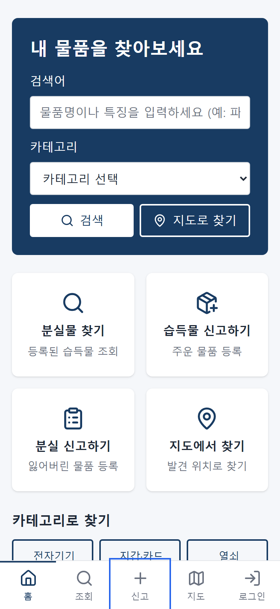
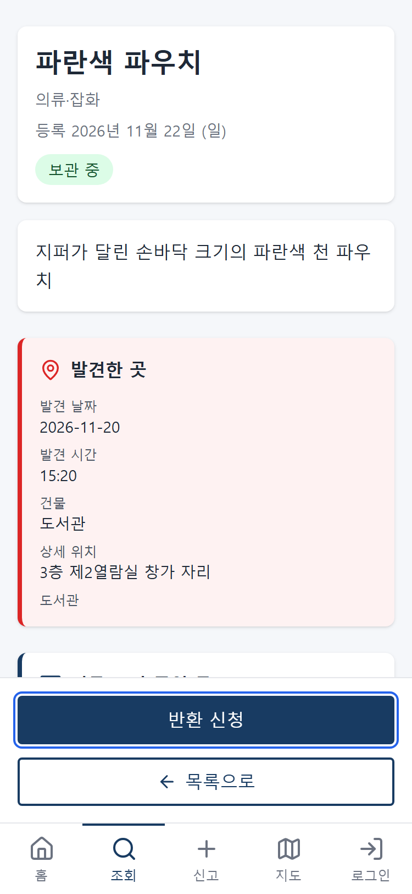
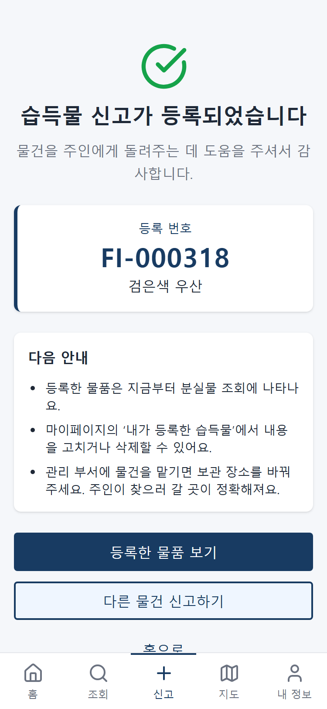
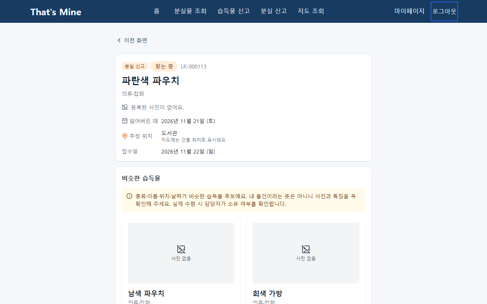
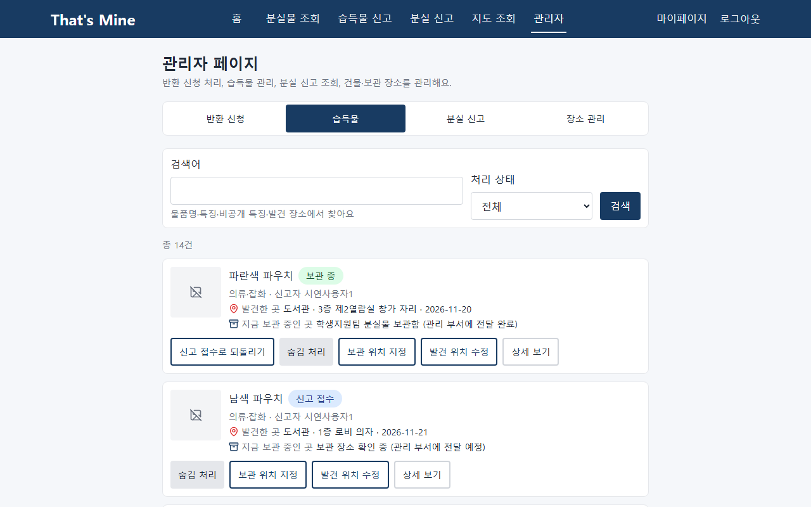
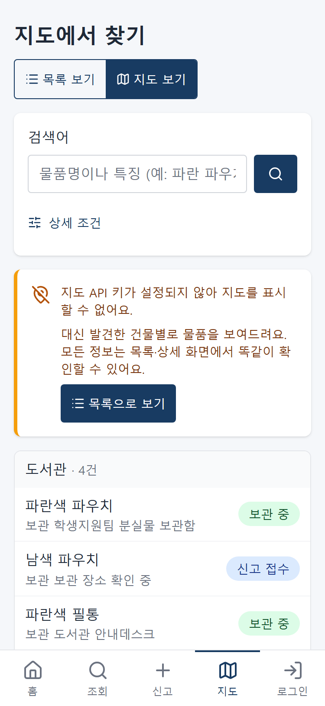

# That's Mine — 교내 분실물 조회 및 신고 시스템

교내에서 습득된 물건과 분실 신고를 한곳에서 조회하고 신고하는 **반응형 웹 앱**입니다. HCI 수업 프로젝트로 만들었고, 기능뿐 아니라 사용성·일관성·오류 예방·피드백을 함께 평가받습니다.

> 이 저장소의 사용자 연구 자료(`docs/223625_*.md`)의 행동·발화·수치는 **가상 사례 기반 초안**입니다. 실제 사용자 조사나 사용성 테스트는 수행하지 않았고, 이 README와 화면의 어떤 수치도 실제 조사 결과가 아닙니다. 시연 데이터(물품·계정·건물 좌표)도 모두 가상입니다.

## 1. 해결하려는 문제 · 대상 사용자 · 목적

- **문제**: 분실물 정보가 커뮤니티·학교 홈페이지·안내데스크 등 여러 곳에 흩어져 있어 같은 물건을 찾으려 여러 번 검색해야 하고, 물건 이름만으로는 내 것인지 판단하기 어려우며, 찾더라도 지금 어디에 보관돼 있는지 따로 알아봐야 합니다.
- **대상 사용자**: 수업 사이 공강(약 10분)에 스마트폰으로 분실물을 확인하는 재학생, 그리고 물건을 주운 사람.
- **목적**: 조회 → 상세(사진·특징·발견 장소·**지금 보관 중인 곳**) → 찾아가는 방법(문의처·운영 시간·준비물)을 끊김 없이 보여 주고, 결과가 없으면 분실 신고로 이어 줍니다. 평가 과업 두 가지를 끝까지 수행할 수 있게 합니다.
  - **과업 A (찾기, 3분)**: 도서관에서 잃어버린 파란색 파우치를 찾아 맞는 물건과 현재 보관 장소를 답한다.
  - **과업 B (신고, 5분)**: 학생회관에서 주운 검은색 우산을 날짜·장소·종류·특징으로 신고해 완료 화면까지 간다.
- 위 목표(5명 중 4명 이상 성공)는 **설계 목표**이며 아직 측정하지 않았습니다.

### 설계에서 지킨 원칙

1. **조회가 주 경로, 지도는 보조 수단.** 지도와 Kakao 키가 없어도 목록→상세만으로 두 과업이 끝까지 됩니다.
2. **발견한 곳과 지금 보관 중인 곳을 섞지 않습니다.** 라벨·아이콘(빨강 MapPin / 파랑 Archive)·색을 분리했습니다.
3. 소유자만 아는 특징·이름·학번·연락처는 공개하지 않습니다. 조회 결과는 소유권 증명이 아니며 **수령 시 담당자가 소유 여부를 확인**합니다(자동 소유 판정 없음).
4. 검색 결과가 없으면 막다른 길이 아니라 분실 신고로 이어지고, 입력한 검색 조건이 신고 폼에 미리 채워집니다.

## 2. 주요 기능

| 영역 | 기능 |
|---|---|
| 조회 | 검색어(동의어 사전으로 "이어폰/에어팟" 표현 차이 흡수)·카테고리·발견 장소·날짜·처리 상태·정렬, 서버 페이지네이션, 목록↔지도 전환 시 조건 유지 |
| 상세 | 사진 갤러리, 발견한 곳 / 지금 보관 중인 곳 구분, 문의처·운영 시간·수령 절차 |
| 습득물 신고 | 단일 페이지 폼, 오늘 기본값·미래 제한, 사진 3장(JPG·PNG·WebP, 장당 5MB, 서버에서 실제 형식 검증), 보관 상태 3가지, 제출 전 미리보기, 완료 화면 |
| 분실 신고 | 날짜 또는 추정 기간, 대표 추정 위치 + 추가 설명, 사진, 본인 수정·삭제 |
| 유사 물품 추천 | 종류·이름·위치·날짜 규칙 점수(AI 미사용). "내 물건이라는 뜻은 아님" 표시 |
| 지도 | Kakao 지도 위 마커(발견·보관·분실·반환 완료), 클러스터, 지도 영역 검색, 위치 선택. 키가 없으면 안내 + 건물별 목록 |
| 계정 | 회원가입·로그인(JWT)·로그아웃(서버가 토큰 무효화)·마이페이지(수정·삭제, 상태별 제한), 로그인 후 원래 화면 복귀 |
| 반환 신청 | 소유 확인 특징으로 신청·취소, 관리자 승인·반려·반환 완료, 한 물품은 한 사람에게만(DB 행 잠금) |
| 관리자 | 전체 습득물·분실 신고 조회, 분실 신고 상태 변경, 숨김, 발견·보관 위치 수정, 반환 신청 처리, 건물·공식 보관 장소 관리 |
| 접근성·반응형 | 375/768/1280px, 터치 영역 44px, 입력 16px, 글자 대비 4.5:1, 키보드·포커스 표시, 대화상자 Esc |

화면 예시(Kakao 키 없는 상태에서 찍은 시연 데이터 화면):

| 홈(모바일) | 상세: 발견한 곳 / 보관 중인 곳(모바일) | 습득물 신고 완료(모바일) |
|---|---|---|
|  |  |  |

| 분실 신고 상세와 유사 습득물(PC) | 관리자: 습득물(PC) | 지도 화면, 키 없음(모바일) |
|---|---|---|
|  |  |  |

전체 스크린샷과 점검 방법은 `docs/screenshots/`, `docs/TEST_RESULTS.md`를 보세요.

## 3. 기술 스택

| 영역 | 사용 기술 |
|---|---|
| Frontend | React 19 + Vite 8 + JavaScript, Tailwind CSS 3.4, React Router 7, Axios, lucide-react, Kakao Maps JS SDK |
| Backend | Java 17, Spring Boot 3.5, Spring Data JPA, Spring Security, JWT(jjwt 0.13), Bean Validation, Gradle Wrapper |
| DB | MySQL(운영·개발), 테스트는 H2(MySQL 모드), 마이그레이션 Flyway |
| 테스트 | JUnit 5·MockMvc(백엔드), Vitest + Testing Library + jsdom(프론트), 헤드리스 Chrome 점검 스크립트 |

## 4. 폴더 구조

```
.
├─ backend/                  Spring Boot (패키지 com.thatsmine)
│  ├─ src/main/java/…        config / controller / service / repository / entity / dto / security / exception / enums
│  ├─ src/main/resources/    application*.yml, db/migration/V1~V4 (Flyway)
│  ├─ src/test/              JUnit 테스트
│  ├─ scripts/               MySQL에 띄운 서버로 보내는 API 점검 스크립트(Python)
│  └─ .env.example           백엔드 환경변수 예시
├─ frontend/                 React (Vite)
│  ├─ src/{api,components,pages,hooks,contexts,utils,constants}
│  ├─ public/demo-photos/    과업 B용 예시 사진
│  └─ .env.example           프론트 환경변수 예시
├─ scripts/browser/          헤드리스 Chrome 점검(audit.mjs 화면 점검, flows.mjs 과업 A·B 수행)
└─ docs/                     SPEC, 설계 근거, API.md, ERD.md, 진행·테스트 기록, 스크린샷
```

## 5. 준비물과 환경변수

필요한 도구: **JDK 17**, **Node.js 22.12 이상(또는 24 LTS)**, **MySQL 8.x**(권장 8.4 LTS), Chrome(브라우저 점검 스크립트용). 설치 확인:

```powershell
java -version; node -v; npm -v; mysql --version
```

> 프로젝트 경로(`C:\That's Mine`)에 **공백과 작은따옴표**가 있습니다. 셸에서 경로는 항상 큰따옴표로 감싸세요. 스크립트에 절대경로를 하드코딩하지 않았습니다.

### 백엔드 환경변수 (`backend/.env.example` 참고)

| 변수 | 설명 | 기본 |
|---|---|---|
| `DB_HOST`, `DB_PORT` | MySQL 주소 | `localhost`, `3306` |
| `DB_NAME` | DB 이름 | 운영 `thatsmine`, dev 프로필 `thatsmine_dev` |
| `DB_USER`, `DB_PASSWORD` | DB 계정 | `root`, 빈 값 — **직접 설정** |
| `JWT_SECRET` | 32자 이상 비밀키. 운영(기본) 프로필은 없으면 시작하지 않음. dev·test는 개발용 고정 키 | **운영은 직접 생성** |
| `JWT_EXPIRATION` | 토큰 유효 시간(ms) | `86400000`(24시간) |
| `UPLOAD_DIR` | 업로드 사진 폴더 | `uploads` |
| `DEMO_ACCOUNT_PASSWORD` | dev 시연 계정 비밀번호 | `demo1234!` |

환경변수는 셸에서 설정합니다(PowerShell: `$env:DB_PASSWORD="…"`). `.env`, `application-local.yml`, `logs/`, `uploads/`는 `.gitignore`에 있으며 **실제 값이 든 파일은 커밋하지 마세요.** JWT 키 만들기 예:

```powershell
[Convert]::ToBase64String((1..48 | ForEach-Object { Get-Random -Max 256 }))
```

### 프론트 환경변수 (`frontend/.env.example`을 복사해 `frontend/.env`)

| 변수 | 설명 |
|---|---|
| `VITE_KAKAO_MAP_KEY` | Kakao JavaScript 키. **비워 두면 지도 대신 안내와 건물별 목록으로 동작** |
| `VITE_API_BASE_URL` | API 주소(기본 `/api/v1`, 개발 서버 프록시가 8080으로 전달) |
| `VITE_CAMPUS_CENTER_LAT`, `VITE_CAMPUS_CENTER_LNG`, `VITE_CAMPUS_MAP_LEVEL` | 지도 중심·확대(시연용 기본값) |

## 6. MySQL 설정

```sql
CREATE DATABASE thatsmine_dev CHARACTER SET utf8mb4 COLLATE utf8mb4_unicode_ci;  -- dev 프로필(개발·시연)
-- 운영 프로필은 thatsmine (DB_NAME으로 바꿀 수 있음)
```

테이블은 서버를 처음 실행할 때 Flyway가 만듭니다(V1~V4). 직접 SQL을 실행할 필요가 없습니다. `root` 대신 전용 계정을 쓰려면 DB 권한을 준 뒤 `DB_USER`/`DB_PASSWORD`를 설정하세요.

## 7. 실행

```powershell
# 1) 백엔드 (dev 프로필: 시연 데이터와 시연 계정 생성)
cd backend
$env:DB_PASSWORD="내_MySQL_비밀번호"
.\gradlew.bat bootRun --args="--spring.profiles.active=dev"      # http://localhost:8080

# 2) 프론트 (다른 터미널)
cd frontend
npm install
npm run dev                                                      # http://localhost:5173
```

빌드·테스트:

```powershell
cd backend;  .\gradlew.bat clean build            # 컴파일 + 테스트(H2)
cd frontend; npm run build; npm run lint; npm test   # Vitest
```

### dev 프로필의 시연 데이터

서버를 dev 프로필로 처음 띄우면 물품 14건(보관 중·접수·반환 진행 중·반환 완료 포함), 분실 신고 4건, 반환 신청 1건, 건물 6곳, 보관 장소 3곳, 계정이 만들어집니다. 모두 가상이며 `[시연용]`을 표시했습니다. 과업 A의 정답 세트(파란색 파우치 / 회색 가방)와 오답 후보, 과업 B용 학생회관·우산 분류·예시 사진(`frontend/public/demo-photos/`)이 들어 있습니다.

**시연 데이터 초기화**(평가 때 참여자마다 같은 상태에서 시작): 관리자로 로그인해 `POST /api/v1/dev/reset-demo`를 호출합니다(dev 프로필에서만 존재). 화면 버튼은 없습니다. 초기화하면 계정이 다시 만들어져 열려 있던 로그인은 만료됩니다.

```powershell
$login = Invoke-RestMethod -Method Post -Uri http://localhost:8080/api/v1/auth/login -ContentType 'application/json' -Body '{"email":"admin@demo.local","password":"demo1234!"}'
Invoke-RestMethod -Method Post -Uri http://localhost:8080/api/v1/dev/reset-demo -Headers @{ Authorization = "Bearer $($login.data.accessToken)" }
```

## 8. 테스트 계정 (dev 프로필 전용)

| 계정 | 역할 | 비밀번호 |
|---|---|---|
| `admin@demo.local` | 관리자(`/admin`) | `demo1234!` (또는 `DEMO_ACCOUNT_PASSWORD`) |
| `user1@demo.local` | 일반 사용자(시연 물품의 신고자) | 위와 같음 |
| `user2@demo.local` | 일반 사용자(분실 신고 3건·반환 신청 1건 보유) | 위와 같음 |

테스트 계정은 dev 프로필에서만 만들어지며 운영 프로필에서는 만들지 않습니다. 가입 화면에서 새 계정을 만들 수도 있습니다(가입으로는 항상 일반 사용자).

## 9. Kakao 지도 키 발급과 허용 도메인

지도는 보조 수단이라 키 없이도 앱 전체와 두 과업이 동작합니다. 지도를 쓰려면:

1. [Kakao Developers](https://developers.kakao.com)에서 애플리케이션을 만들고 **JavaScript 키**를 확인합니다.
2. 앱 설정의 **플랫폼 → Web**에 사이트 도메인을 등록합니다. 개발은 `http://localhost:5173`, 배포하면 배포 주소를 추가합니다. (등록하지 않으면 지도가 회색으로만 보입니다.)
3. 카카오맵 사용 설정이 필요한 경우 앱 설정에서 켭니다(메뉴 이름은 바뀔 수 있으니 공식 안내를 확인하세요).
4. `frontend/.env`의 `VITE_KAKAO_MAP_KEY`에 키를 넣고 `npm run dev`를 다시 시작합니다.

키 값은 저장소에 올리지 마세요(`frontend/.env`는 `.gitignore` 대상). 이 환경에서는 키가 없어 **실제 지도 화면 동작은 확인하지 못했습니다**(`docs/VERIFICATION_CHECKLIST.md` 8·9번).

## 10. 검증 · 문서

| 문서 | 내용 |
|---|---|
| [`docs/TEST_RESULTS.md`](docs/TEST_RESULTS.md) | 실제 실행한 명령과 결과(통과·실패 개수), 실행하지 못한 것 |
| [`docs/VERIFICATION_CHECKLIST.md`](docs/VERIFICATION_CHECKLIST.md) | SPEC §27의 20개 검증 항목별 근거와 수동 확인 절차 |
| [`docs/REQUIREMENTS_TRACE.md`](docs/REQUIREMENTS_TRACE.md) | 기획 문서·SPEC 요구사항 ↔ 구현 화면·파일·상태 |
| [`docs/DESIGN_RATIONALE.md`](docs/DESIGN_RATIONALE.md) | 연구 인사이트 ↔ 설계 결정 추적표 |
| [`docs/USABILITY_TEST_READY.md`](docs/USABILITY_TEST_READY.md) | 과업 A·B 진행 스크립트와 빈 기록지(사용성 테스트는 아직 수행하지 않음) |
| [`docs/API.md`](docs/API.md), [`docs/ERD.md`](docs/ERD.md) | REST API 명세, ERD(Mermaid) |
| [`docs/PROGRESS.md`](docs/PROGRESS.md) | 단계별 구현·결정·발견한 문제와 수정 기록 |

MySQL에 서버를 띄운 뒤 쓰는 점검 스크립트:

```powershell
python backend/scripts/mysql_api_check_stage7_9.py     # 지도·인증·분실 신고·마이페이지
python backend/scripts/mysql_api_check_stage10.py      # 반환 신청·관리자·동시성
python backend/scripts/mysql_api_check_stage11.py      # 유사 물품 추천
python backend/scripts/mysql_api_check_stage12.py     # 로그아웃 무효화·중복 제출 방지·관리자 분실 신고 상태 변경
python backend/scripts/check_demo_reset.py             # 시연 데이터 초기화 재현성
node scripts/browser/flows.mjs                         # 과업 A·B 등 주요 흐름을 헤드리스 Chrome(375px)으로 수행
node scripts/browser/audit.mjs                         # 22개 화면(없는 주소 포함) × 3개 화면 크기 점검(넘침·터치·대비·라벨·포커스)
```

(각 스크립트는 시연 데이터를 바꾸므로 끝에 초기화하거나 시작할 때 초기화합니다. `flows.mjs`·`audit.mjs`는 Chrome이 필요하며 `CHROME_PATH`로 경로를 지정할 수 있습니다.)

## 11. 직접 설정해야 할 항목 · 알려진 한계

**직접 설정**: MySQL 설치와 `DB_PASSWORD`(DB 계정), 운영 배포 시 `JWT_SECRET`, 지도를 쓰려면 Kakao JavaScript 키와 허용 도메인, 실제 캠퍼스 좌표·건물·보관 장소 정보(현재는 시연용).

**한계(숨기지 않고 적습니다)**
- 사람 대상 사용성 테스트는 수행하지 않았습니다. 성공률 목표(5명 중 4명)는 설계 목표입니다.
- Kakao 키가 없는 상태로만 점검해 실제 지도 렌더링·마커·클러스터는 확인하지 못했습니다.
- 실제 스마트폰이 아니라 Chrome의 화면 크기 에뮬레이션으로 반응형을 점검했습니다.
- 로그인 시도 횟수 제한이 없습니다. 토큰은 `localStorage`에 보관합니다(로그아웃하면 서버가 그 토큰을 무효화합니다).
- 중복 제출 방지(같은 내용의 신고를 60초 안에 다시 보내면 거절)는 **서버 한 대 기준**입니다. 여러 대로 늘리면 DB 제약이 더 필요합니다.
- 유사 물품 추천의 정확도는 검증하지 않았습니다(시연 데이터 몇 건의 순위만 확인). 동의어 사전은 20여 개입니다.
- 알림(푸시·이메일), 학교 시스템 연동, 자동 소유 판정, 배송은 범위 밖입니다(제안서 §4).
- 테스트는 MySQL 8.4 LTS가 아니라 로컬 MySQL 26.10에서 실행했습니다.
- 배포와 GitHub 공유는 13단계 범위입니다.
