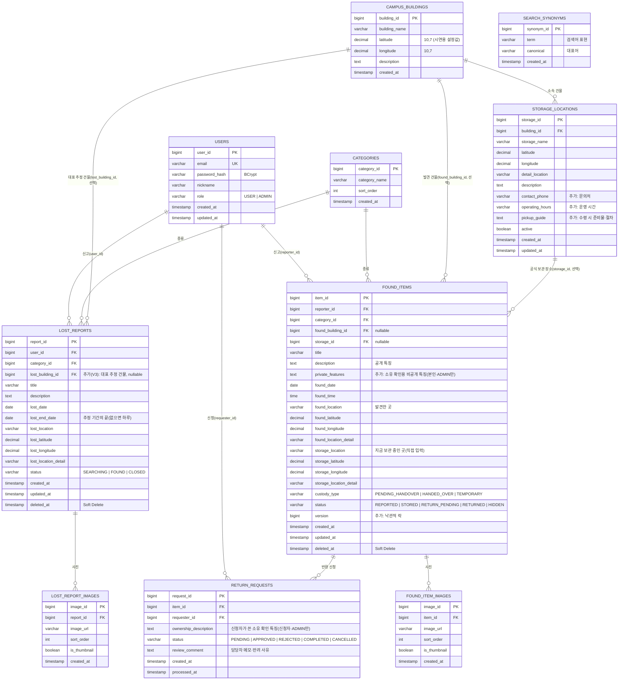

# ERD

스키마는 Flyway 마이그레이션이 만든다(`backend/src/main/resources/db/migration/V1__init.sql`, `V2__align_categories_with_spec.sql`, `V3__lost_report_building_and_indexes.sql`). Hibernate는 스키마를 만들거나 바꾸지 않는다(`ddl-auto: none`). 테스트(H2)만 Hibernate가 스키마를 만든다.

`SEARCH_SYNONYMS`는 다른 테이블과 외래키로 이어지지 않는다(검색어를 넓힐 때만 쓰는 사전).

## SPEC §18과 다른 점 (연구 문서·설계 근거로 추가)

| 테이블.컬럼 | 추가·변경 이유 |
|---|---|
| `storage_locations.contact_phone`, `operating_hours`, `pickup_guide` | 보관 장소 다음에 "어떻게 찾아가나"(문의처·운영 시간·수령 시 준비물)를 보여주기 위해(I03, UI방법론 프레임 3) |
| `found_items.private_features` | 습득자가 남기는 소유 확인용 비공개 특징. 공개 응답에는 필드를 두지 않고 신고자 본인과 ADMIN만 본다 |
| `found_items.version` | 반환 처리 동시성의 보조 안전장치(낙관적 락). 주된 중복 반환 방지는 행 잠금(`SELECT … FOR UPDATE`) |
| `lost_reports.lost_building_id` (V3) | 건물만 고른 분실 신고도 지도 표시·유사 물품 추천에서 위치를 쓰려고. 습득물의 `found_building_id`와 같은 방식 |
| `search_synonyms` | 검색어 표현 차이 흡수(이어폰↔에어팟, M05). SPEC §18 목록에는 없는 테이블 |
| 인덱스(V1·V3) | 카테고리·상태·날짜·좌표·신고자·삭제 시각, 분실 신고 날짜·좌표·건물 |

SPEC §18과 같은 점: PK는 BIGINT, 위·경도는 DECIMAL(10,7), 외래키로 참조 무결성 유지, 신고 삭제는 Soft Delete(`deleted_at`), 삭제된 데이터는 일반 검색·지도·추천에서 제외.

## 규칙·참고

- **발견 위치와 보관 위치는 별도 컬럼**(`found_*` / `storage_*`)에 독립적으로 저장한다. 보관 위치는 `custody_type`이 `HANDED_OVER`일 때만 값이 있다.
- 습득물 `status`(처리 상태)와 `custody_type`(보관 유형)은 서로 독립이다.
- 삭제는 `deleted_at` 설정이며 행과 반환 신청 이력은 남는다.
- 카테고리 ID·이름은 프론트 `constants/categories.js`(서버 응답이 없을 때의 대체 목록)와 같아야 한다(V2가 SPEC §7 기준으로 맞춤).
- 시연 데이터(dev 프로필)는 `config/DemoDataSeeder.java`가 만들며 `[시연용]`을 표시한다. 건물 좌표는 실제 캠퍼스 정보가 아니다.
