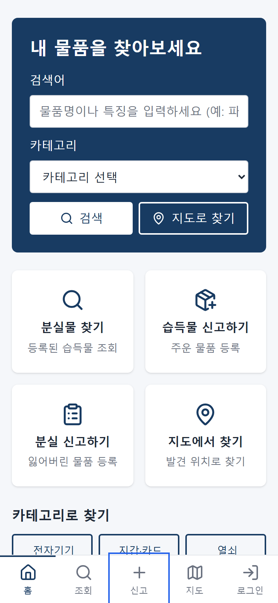
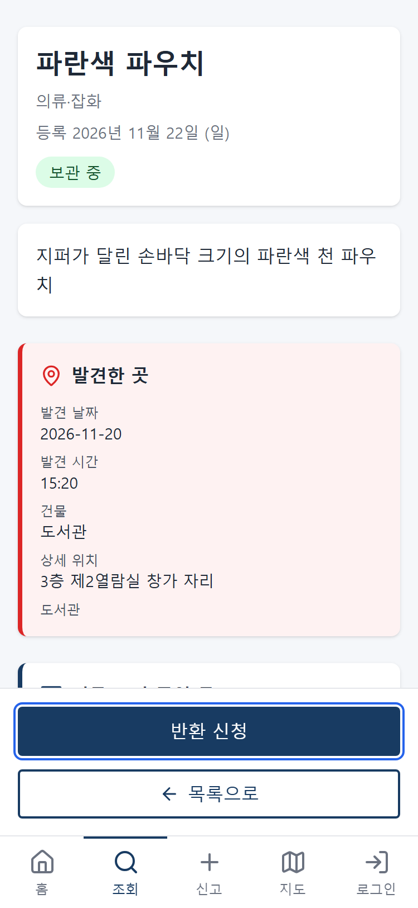
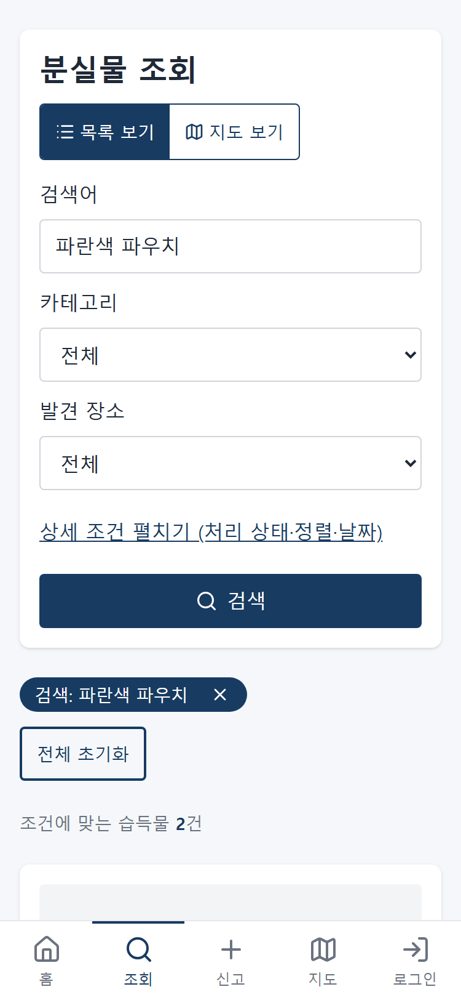
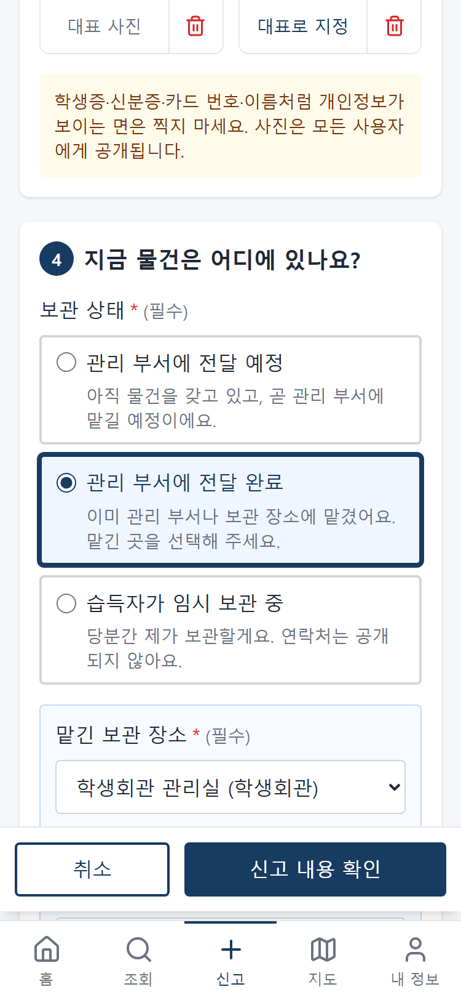
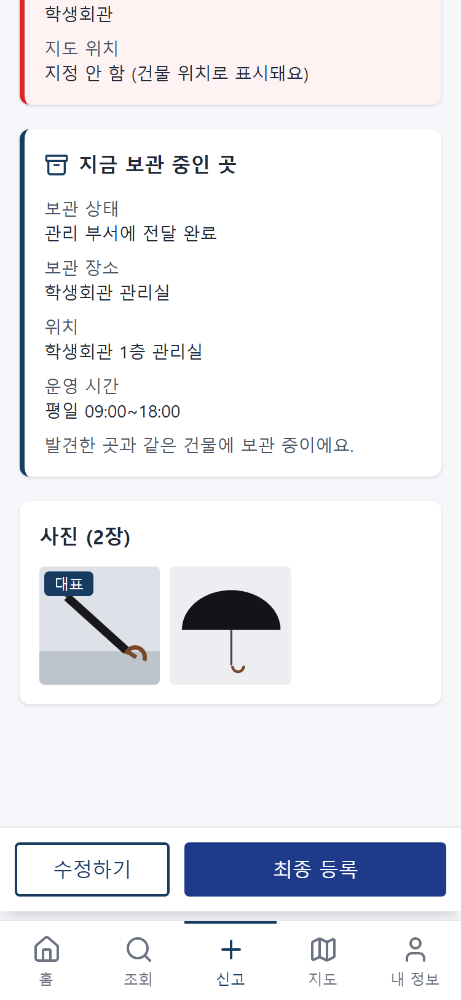
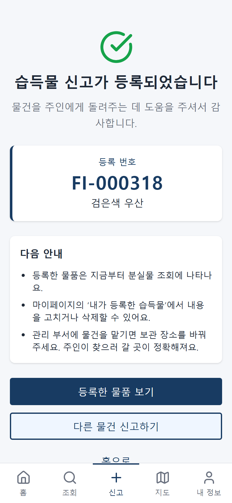
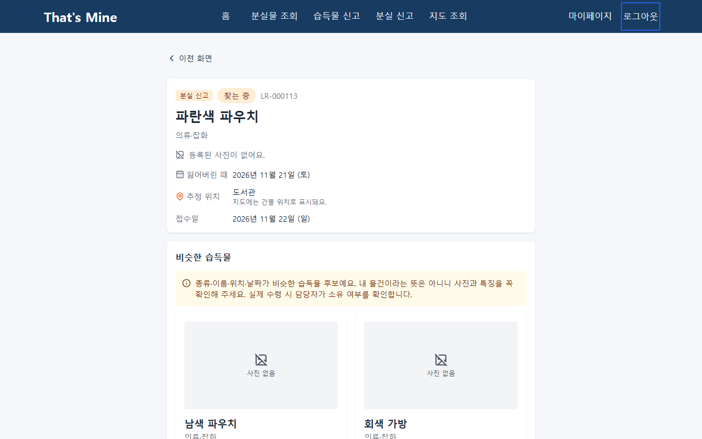
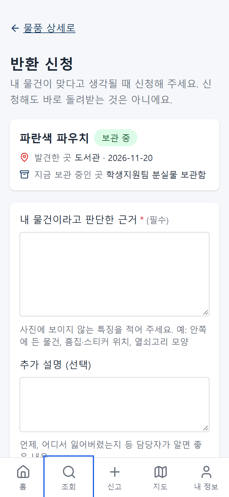
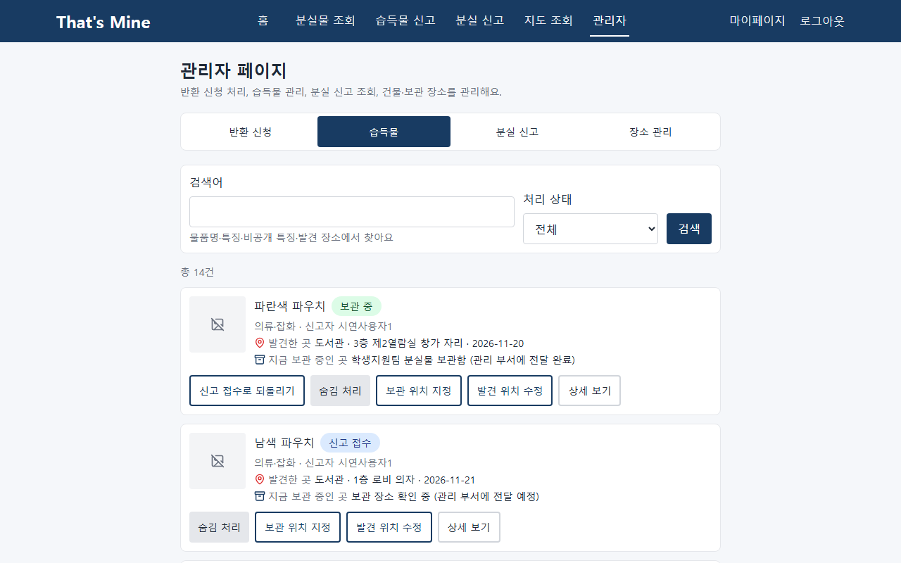

# 제출용 요약 (SUBMISSION)

과제 제출물 ①~④를 이 문서 하나에서 모두 찾을 수 있게 정리했다. 연구 문서의 행동·발화·수치는 **가상 사례 기반 초안**이며, 실제 사용자 조사나 사용성 테스트는 수행하지 않았다.

## 1. 프로젝트

**That's Mine — 교내 분실물 조회 및 신고 시스템.** 교내 습득물과 분실 신고를 한곳에서 조회·신고하는 반응형 웹 앱(React + Spring Boot + MySQL).

- **해결하려는 문제**: 분실물 정보가 커뮤니티·학교 홈페이지·안내데스크에 흩어져 같은 물건을 찾으려 여러 번 검색해야 하고, 이름만으로는 내 물건인지 알기 어려우며, 찾아도 지금 어디에 보관돼 있는지 따로 알아봐야 한다.
- **대상 사용자**: 수업 사이 공강(약 10분)에 스마트폰으로 분실물을 확인하는 재학생, 물건을 주운 사람.
- **목적**: 조회 → 상세(사진·특징·발견한 곳·**지금 보관 중인 곳**) → 찾아가는 방법(문의처·운영 시간·준비물)을 끊김 없이 보여 주고, 결과가 없으면 분실 신고로 잇는다. 평가 과업 A(물건 찾기, 3분)·B(습득물 신고, 5분)를 끝까지 수행할 수 있게 한다. 목표(5명 중 4명 이상 성공)는 설계 목표이며 측정하지 않았다.

## 2. 사용자 요구사항 → 구현 기능 (요약)

전체 표(근거 문서·절, 화면 경로, 주요 파일, 상태)는 [`REQUIREMENTS_TRACE.md`](REQUIREMENTS_TRACE.md), 설계 근거는 [`DESIGN_RATIONALE.md`](DESIGN_RATIONALE.md).

| 요구사항(근거) | 구현 | 상태 |
|---|---|---|
| 여러 곳을 돌지 않고 물품명·종류·날짜·장소로 조회 (I01, 우선순위 1) | `/items` 통합 조회(검색어·카테고리·발견 장소·날짜·상태·정렬, 서버 페이지네이션), 동의어 사전 | 구현 |
| 사진·특징·발견 위치로 물건을 구별 (I02, 우선순위 2) | `/items/:id` 사진 갤러리·특징·발견한 곳 | 구현 (지도 표시는 Kakao 키 없이 확인 못 함) |
| 보관 장소·문의·결과 없음 시 분실 신고 연결 (I03, 우선순위 3) | 상세의 "지금 보관 중인 곳"·찾아가는 방법, 결과 없음 → 분실 신고(검색 조건 미리 채움) | 구현 |
| 습득자가 물품·위치를 등록 (우선순위 4, 과업 B) | `/report-found` → 미리보기 → 완료, 사진 3장·서버 형식 검증 | 구현 |
| 발견한 곳과 보관 중인 곳을 혼동시키지 않음 | 라벨·아이콘(빨강/파랑)·색 분리 | 구현 (혼동 여부는 테스트 전) |
| 소유자 정보 비공개, 조회 결과 ≠ 소유권 증명 | 공개/관리자 DTO 분리, "담당자가 소유 여부를 확인" 안내 | 구현 |
| 모바일 우선 | 하단 메뉴, 375/768/1280px 점검 | 구현 |
| 지도는 보조 수단(키 없어도 과업 완료) | 키 없을 때 안내 + 건물별 목록 | 구현 |
| SPEC 추가 기능: 로그인·마이페이지·분실 신고·반환 신청·관리자·유사 물품 추천 | 각각 구현(연구 근거는 없음) | 구현 |

## 3. 주요 기능과 화면

| 홈(모바일) | 상세: 발견한 곳 / 보관 중인 곳 | 과업 A 검색 결과 |
|---|---|---|
|  |  |  |

| 과업 B 입력 | 과업 B 미리보기 | 과업 B 완료 |
|---|---|---|
|  |  |  |

| 분실 신고와 유사 습득물(PC) | 반환 신청 | 관리자(PC) |
|---|---|---|
|  |  |  |

스크린샷 전체는 `docs/screenshots/`(모바일·PC 43장). Kakao 지도가 보이는 화면은 키가 없어 찍지 못했다.

### 사용 흐름 2개

**분실한 학생(과업 A)**: 홈에서 "파란색 파우치" 검색 → 목록에서 상태(보관 중/반환 완료)와 발견 장소로 후보를 구별 → 상세에서 "발견한 곳(도서관)"과 "지금 보관 중인 곳(행정관 학생지원팀)" 확인 → 운영 시간·문의처·준비물 확인, 수령 때는 담당자가 소유 여부를 확인 → 내 물건이면 반환 신청(로그인), 없으면 분실 신고(검색 조건이 폼에 채워짐) → 유사 습득물 추천 확인.

**습득자(과업 B)**: 습득물 신고(로그인 필요, 로그인 후 원래 화면으로 복귀) → 종류·물품명·특징·발견 날짜(오늘 기본)·장소(건물 선택 또는 지도) → 사진 선택·보관 상태(관리 부서 전달 예정/완료/임시 보관) → 신고 내용 확인(미리보기) → 제출 → 접수 번호가 있는 완료 화면. 이후 마이페이지에서 수정·삭제.

## 4. 링크와 실행 방법

| 항목 | 값 |
|---|---|
| GitHub 저장소 | https://github.com/bestash1278/That-s-Mine (기본 브랜치 `master`) |
| 배포 주소 | (배포 후 입력) — 배포 안내 [`DEPLOY.md`](DEPLOY.md), 현재 "배포 확인 대기" |
| 프롬프트 기록 | [`PROMPT_HISTORY.md`](PROMPT_HISTORY.md) |
| 설명 문서 | [`../README.md`](../README.md), [`API.md`](API.md), [`ERD.md`](ERD.md) |

**로컬 실행 (Docker, 명령 하나)** — `.env.example`을 `.env`로 복사해 `DB_PASSWORD`, `JWT_SECRET`, `DEMO_ACCOUNT_PASSWORD`를 채운 뒤:

```powershell
docker compose up --build        # → http://localhost:8080  (※ 이 PC에는 Docker가 없어 실행해 보지 못함)
```

**로컬 실행 (수동, 확인함)** — MySQL이 켜져 있고 DB `thatsmine_dev`가 있을 때:

```powershell
cd backend;  $env:DB_PASSWORD="<DB 비밀번호>"; .\gradlew.bat bootRun --args="--spring.profiles.active=dev"   # http://localhost:8080
cd frontend; npm install; npm run dev                                                                     # http://localhost:5173
```

프론트를 포함한 단일 jar(배포 형태): `powershell -ExecutionPolicy Bypass -File .\scripts\build-single.ps1` 후 `java -Dspring.profiles.active=demo -jar backend\build\libs\app.jar`(환경변수 필요, [`DEPLOY.md`](DEPLOY.md) 참고). 이 방식은 실제로 실행하고 스모크 테스트 14개를 통과했다.

## 5. 시연 계정

| 이메일 | 역할 |
|---|---|
| `admin@demo.local` | 관리자 |
| `user1@demo.local` | 일반 사용자(시연 물품의 신고자) |
| `user2@demo.local` | 일반 사용자(분실 신고 3건·반환 신청 1건) |

**비밀번호는 이 문서에 적지 않는다. 제출 때 따로 전달한다.** 배포용 `demo` 프로필은 환경변수 `DEMO_ACCOUNT_PASSWORD`로 정한 값이 비밀번호이고, 로컬 `dev` 프로필의 기본 비밀번호는 README에 적힌 개발용 값이다(운영·배포에서는 쓰지 않는다).

## 6. 테스트 결과 (실제 실행, 2026-11-22)

자세한 명령과 한계는 [`TEST_RESULTS.md`](TEST_RESULTS.md), SPEC §27 20항목은 [`VERIFICATION_CHECKLIST.md`](VERIFICATION_CHECKLIST.md).

| 항목 | 결과 |
|---|---|
| 백엔드 `gradlew test` (H2) | 136개 통과, 실패 0 |
| 프론트 `npm test` | 19개 파일, 100개 통과 |
| `npm run build` / `npm run lint` | 통과 / 오류 0(경고 16) |
| MySQL 위 서버에 실제 HTTP 요청(점검 스크립트 4종, 동시 요청 포함) | 33 / 91 / 29 / 28개 통과 |
| 헤드리스 Chrome 흐름(과업 A·B 등, 375px) | 36단계 통과 |
| 화면 점검(22개 화면 × 375·768·1280px = 66회) | 가로 넘침·터치·대비·라벨·포커스·콘솔 오류 0건 |
| 배포 형태 스모크 테스트(단일 jar, demo 프로필, 로컬 주소) | 14 통과 / 0 실패 |
| SPEC §27 검증 20항목 | 통과 18, 부분 통과 2(지도 화면 2건) |

## 7. 한계와 미구현

- 사람 대상 **사용성 테스트는 하지 않았다**(성공률·소요 시간 미측정). 진행 준비물은 [`USABILITY_TEST_READY.md`](USABILITY_TEST_READY.md).
- **Kakao 키가 없어** 실제 지도 렌더링(마커·클러스터·드래그·현재 위치)은 확인하지 못했다. 키 없는 대체 화면과 서버 API는 확인했다.
- **배포하지 않았다**(사용자 작업). Docker 이미지 빌드·`docker compose`는 이 PC에 Docker가 없어 실행해 보지 못했고, TiDB Cloud/Render에서의 동작도 미확인이다.
- 실제 스마트폰·스크린리더로는 확인하지 않았다(Chrome 화면 크기 에뮬레이션). 로컬 MySQL은 프로젝트 기준(8.4 LTS)이 아니라 26.10이다.
- 로그인 시도 제한 없음, 토큰은 `localStorage`, 중복 제출 방지는 서버 한 대 기준, 시연 데이터 초기화 화면 버튼 없음(요청에 따라 제외). 유사 물품 추천의 정확도와 동의어 사전(20여 개)은 검증·확장하지 않았다.
- 알림(푸시·이메일), 학교 시스템 연동, 자동 소유 판정, 배송은 범위 밖이다(제안서 §4).
- 무료 배포 플랫폼에서는 잠자기와 업로드 사진 소실이 있다([`DEPLOY.md`](DEPLOY.md) 6번).

## 8. 과제 요구사항 체크표

상태: **완료** / **사용자 작업 필요** / **미완료**

### 제출물

| # | 제출물 | 파일·링크 | 상태 |
|---|---|---|---|
| ① | 소스 코드(GitHub 저장소) | https://github.com/bestash1278/That-s-Mine · 원격(`origin`)에 push됨(아래 push 기록은 `docs/PROGRESS.md` 13단계). 공개/비공개는 사용자가 정한다 | 완료(공개 범위는 **사용자 작업 필요**) |
| ② | 실행 가능한 결과물 또는 배포 링크 | `Dockerfile`, `docker-compose.yml`, `render.yaml`, [`DEPLOY.md`](DEPLOY.md), `scripts/build-single.ps1`·`smoke-test.ps1`. 단일 jar 실행·스모크 14개 확인 | 실행 가능한 결과물은 **완료**, 배포 링크는 **사용자 작업 필요** |
| ③ | 개발 과정에서 사용한 프롬프트 전체(순서대로) | [`PROMPT_HISTORY.md`](PROMPT_HISTORY.md) (52건: 앱 채팅 16, Claude Code 36) | 완료 |
| ④ | 프로젝트 설명·주요 기능 요약 | 이 문서, [`../README.md`](../README.md) | 완료 |

### 평가 기준

| # | 평가 기준 | 근거 파일 | 상태 |
|---|---|---|---|
| 1 | 기획과 구현의 일치 | [`REQUIREMENTS_TRACE.md`](REQUIREMENTS_TRACE.md), [`DESIGN_RATIONALE.md`](DESIGN_RATIONALE.md) §8 | 완료(부분 구현·미구현은 이유와 함께 표시) |
| 2 | 주요 기능 정상 작동 | [`TEST_RESULTS.md`](TEST_RESULTS.md), [`VERIFICATION_CHECKLIST.md`](VERIFICATION_CHECKLIST.md) | 완료(지도 화면 2항목은 부분 통과) |
| 3 | UI 완성도 | `docs/screenshots/`, [`PROGRESS.md`](PROGRESS.md) 12단계(점검 66회, 개선 16건) | 완료(실제 기기·지도 화면 미확인) |
| 4 | 개선 과정 | [`PROGRESS.md`](PROGRESS.md) 12단계 "발견한 문제 → 원인 → 수정 → 파일" 표, 12단계 후속, [`PROMPT_HISTORY.md`](PROMPT_HISTORY.md) | 완료 |
| 5 | (과제 안내문의 다섯 번째 평가 기준) | 저장소에는 `prompts/12.md`가 적은 네 가지(위 1~4)만 있고 안내문 원문이 없어 **다섯 번째 기준을 확인하지 못했다** | **사용자 작업 필요**: 안내문의 다섯 번째 기준을 알려 주면 이 칸에 파일·상태를 채운다 |
